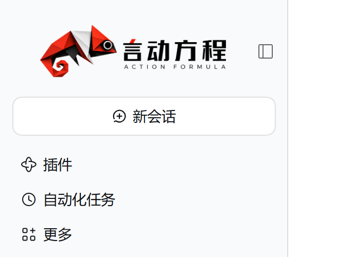

# dsh-brand-logo

把 DeepSeek Harness 侧边栏左上角的品牌位替换为「言动方程 ACTION FORMULA」横版 Logo，
其余界面保持不变。关闭插件即可恢复原品牌。

Replace the DeepSeek Harness sidebar brand lockup with the Action Formula
(言动方程) logo. Everything else in the interface stays unchanged; turning the
plugin off restores the original brand.



## 效果

- 启用后：左上角显示言动方程横版 Logo（默认高 72px，宽 214px，随品牌栏宽度自适应）。
- 关闭后：官方 DeepSeek Harness 品牌原样恢复（本插件禁用官方品牌行的那一层随插件一起卸载）。
- 只改动侧边栏品牌位；新会话按钮、插件/自动化任务/更多入口、工作区与会话列表、聊天区均不受影响。

## 安装

### 方式一：插件市场（收录后）

在 DSH 中打开 **插件 → 发现 / 插件市场**，搜索 `dsh-brand-logo`，
点安装即可。安装后通常刷新页面或由 HMR 自动生效。

### 方式二：直接安装本仓库的 Release 包

在 **插件 → 添加插件** 里粘贴下面这个地址：

```
https://github.com/dadiaoliyaqiao-max/dsh-brand-logo/releases/latest/download/dsh-brand-logo.tgz
```

或用命令行：

```sh
dsh plugin --profile <profile> add https://github.com/dadiaoliyaqiao-max/dsh-brand-logo/releases/latest/download/dsh-brand-logo.tgz
```

> 桌面端（Desktop）的 profile 由应用自己的插件管理器管理，请在应用内安装。

### 方式三：从源码目录安装（开发）

```sh
dsh plugin --profile web add /path/to/dsh-brand-logo
```

## 开关与卸载

- **关闭（保留安装）**：**插件 → 已安装插件** → `dsh-brand-logo` 右侧开关；品牌立即恢复原样。
- **卸载**：同一行的移除入口，或在插件市场卡片上卸载；卸载后品牌恢复原样。

## 自定义

- 改 Logo 高度：`node build.mjs 64`（默认 72，单位 px；宽高比自动保持）。
  不超过约 78px，再大品牌栏会挤压折叠按钮。
- 换 Logo：用新的透明底横版 PNG 覆盖 `logo.png`（建议宽高比接近 2.96:1、宽度 ≥ 900），
  再运行 `node build.mjs 72` 重新生成 `client.js`。
- 生成文件 `client.js` 已内嵌图片，发布时只需提交构建产物。

## 实现

标准 DSH 组合包（bundle），不修改 DSH 安装文件：

| 文件 | 作用 |
|---|---|
| `package.json` | 声明 `dsh.bundle.patch` 与 `dsh.client`（web 平台、`immediately`、依赖 renderer/sidebar） |
| `cordis.patch.yml` | 组合层：禁用官方品牌行 `ui-brand-official`，插入本插件行 `brand-dsh-brand-logo` |
| `index.js` | Host 半侧空实现（本插件只贡献浏览器端 UI） |
| `client.js` | 浏览器端 bundle：占住 `sidebar.brand.mark` / `sidebar.brand.name` 两个 slot，渲染内嵌 base64 Logo |
| `client.template.js` / `build.mjs` | 生成 `client.js` 的模板与构建脚本（`__LOGO_B64__` / `__LOGO_HEIGHT__` 占位符） |
| `logo.png` | 900×303 透明底素材，构建时内嵌进 `client.js` |
| `locale/*.json` | 插件页的中英文标题与说明 |
| `icon.png` | 插件图标 |

品牌位本身是 slot：`sidebar.brand.mark`（图标）与 `sidebar.brand.name`（字标）。
本插件占住两者：mark slot 渲染完整横版 Logo，name slot 返回空，避免外壳回退到
「本地构建」字样。

## 兼容性

- 已在 DSH `0.2.2-rc.3` 上实测：Logo 正常渲染（214×72），官方品牌行与本地构建字样不再显示，
  其余界面无变化。
- 依赖 DSH Web 客户端的 `sidebar.brand.*` slot 与 `window.__ModuleLoader__` 客户端 bundle 机制；
  若未来 DSH 大版本改动侧边栏结构，可能需要小幅更新 CSS 选择器。
- 图片内文字为深色，深色主题下对比度偏低；官方浅色主题下效果最佳。

## License

MIT（Logo 与「言动方程 / ACTION FORMULA」商标归言动方程所有，仅用于品牌方自身的部署）。
